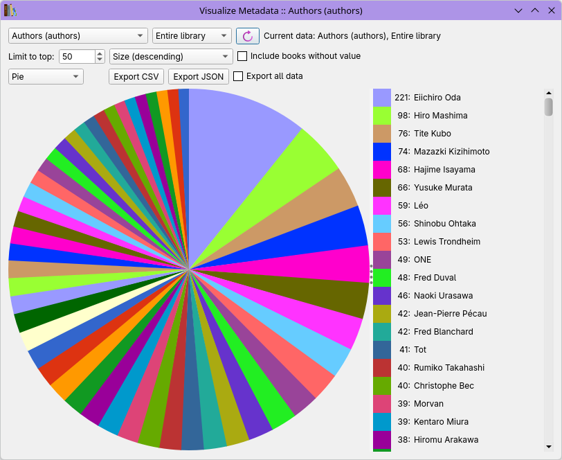
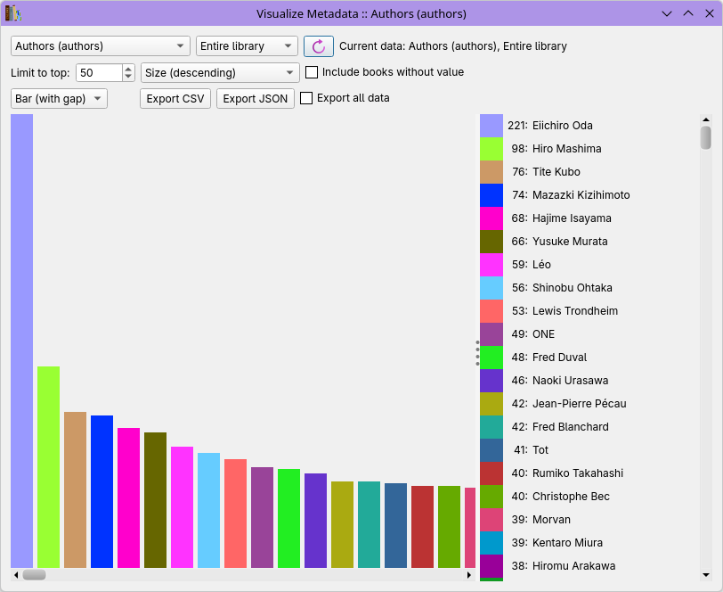

# Visualize Metadata
[![MobileRead][mobileread-image]][mobileread-url]
[![History][changelog-image]][changelog-url]
[![License][license-image]][license-url]
[![calibre Version][calibre-image]][calibre-url]
[![Status][status-image]][status-image]

*Visualize Metadata* is a small plugin to visualize into a chart the metadata statistics in your Calibre library.

The plugin has the following features:
* Display the values into different chart
    * Pie
    * Pie (outline)
    * Bar
    * Bar (with gap)
* Limit analyze to scope:
    * Entire library
    * Virtual library
    * Current search
* Show top X values
    * or all of them (special value 0)
* Include books without value in the chart
* Sorting by:
    * Alphabetical (ascending & descending)
    * Size (ascending & descending)
* Additional grouping option for date:
    * Year
    * Month
    * Day
    * Hour
    * Minute
* Export data to CSV or JSON

This plugin attempt to be a autnomous version and replacement of the similar feature in [Job Spy](https://www.mobileread.com/forums/showthread.php?t=269911) plugin by DaltonST.

**Special Notes:**

* If you switch libraries, all dialogs open will be automaticly closed.

**Installation**

Open *Preferences -> Plugins -> Get new plugins* and install the "Visualize Metadata" plugin.
You may also download the attached zip file and install the plugin manually, then restart calibre as described in the [Introduction to plugins thread](https://www.mobileread.com/forums/showthread.php?t=118680")

The plugin works for Calibre 5 and later.

Page: [GitHub](https://github.com/un-pogaz/Visualize-Metadata) | [MobileRead](https://www.mobileread.com/forums/showthread.php?t=XXXX)

<ins>Note for those who wish to provide a translation:</ins> 
I am *French*! Although for obvious reasons, the default language of the plugin is English, keep in mind that already a translation.

  

[mobileread-url]: https://www.mobileread.com/forums/showthread.php?t=376313

[changelog-image]: https://img.shields.io/badge/History-CHANGELOG-blue.svg
[changelog-url]: changelog.md

[license-image]: https://img.shields.io/badge/License-GPL-yellow.svg
[license-url]: LICENSE

[calibre-image]: https://img.shields.io/badge/calibre-5.00.0_and_above-green?logo=
[calibre-url]: https://www.calibre-ebook.com/

[status-image]: https://img.shields.io/badge/Status-Stable-green

[mobileread-image]: https://img.shields.io/badge/MobileRead-Plugin%20Thread-blue?logo=
